# 🚗 Pipeline ALPR: Detecção de Placas Veiculares & OCR

[](https://www.python.org/downloads/)
[](https://opencv.org/)
[](https://www.tensorflow.org/lite)
[](https://github.com/ultralytics/ultralytics)
[](https://opensource.org/licenses/MIT)

Pipeline de visão computacional de ponta a ponta para **reconhecimento e leitura automática de placas veiculares (ALPR/LPR)** com validação para os padrões brasileiros (Mercosul e Tradicional).

---

## 🏗️ Arquitetura do Pipeline

```mermaid
graph LR
    Input[📸 Imagem do Veículo] --> Model[Detecção YOLO / TFLite]
    Model --> Crop[Recorte com Margem Dinâmica]
    Crop --> Bicubic[Super-Resolução Bicúbica]
    Bicubic --> Filter[Filtro Bilateral: Denoise com Preservação de Bordas]
    Filter --> CLAHE[CLAHE: Equalização de Contraste Local]
    CLAHE --> Sharp[Unsharp Mask: Realce de Nitidez]
    Sharp --> Binary[Binarização Adaptativa Gaussiana]
    Binary --> OCR[Motor de OCR: EasyOCR / PyTesseract]
    OCR --> Regex[Validador Regex Mercosul / Tradicional]
```



---

## 🌟 Funcionalidades Principais

- **🎯 Detecção Leve em Tempo Real:** Arquiteturas otimizadas (YOLO e EfficientDet-Lite) para execução eficiente em dispositivos locais e de borda.
- **📐 Enquadramento com Margem Dinâmica:** Expansão percentual configurável da *bounding box* para prevenir corte de caracteres em detecções justas.
- **✨ Filtros Morfológicos & Pré-processamento com OpenCV:**
  - Redimensionamento bicúbico para recuperação de detalhes em placas distantes.
  - Filtro bilateral que elimina ruídos granulados preservando arestas dos dígitos.
  - CLAHE (equalização adaptativa de histograma) para lidar com sombras e iluminação irregular.
  - Binarização adaptativa e abertura morfológica para limpar reflexos.
- **🔤 Reconhecimento de Caracteres (OCR):** Extração de texto integrada com suporte a **EasyOCR** e **PyTesseract**.
- **🇧🇷 Classificação de Padrão Brasileiro:** Identificação e validação automática via regex:
  - **Padrão Mercosul:** Formato `ABC1D23` (`[A-Z]{3}[0-9][A-Z0-9][0-9]{2}`)
  - **Padrão Tradicional:** Formato `ABC1234` (`[A-Z]{3}[0-9]{4}`)

---

## 🚀 Como Executar

### 1. Clonar e Instalar Dependências
```bash
git clone https://github.com/IgorBarduzzi/license-plate-detection-ocr.git
cd license-plate-detection-ocr

python -m venv .venv
# No Windows:
.venv\Scripts\activate
# No Linux/Mac:
source .venv/bin/activate

pip install -r requirements.txt
```

### 2. Inferência e Reconhecimento OCR
Execute o script passando o caminho da imagem e do modelo treinado:
```bash
python inference_ocr.py --model models/best_float16.tflite --source test_images/exemplo.jpg --outdir ocr_debug
```

Os resultados (imagem anotada, recortes individuais, imagens binarizadas e o relatório em JSON com placas e tipos identificados) serão gerados na pasta de saída.

### 3. Treinamento de Modelo Customizado
Para treinar seu próprio detector com anotações em Pascal VOC (XML):
```bash
python train_plate_inplace.py
```

---

## 📁 Estrutura do Repositório

```
├── inference_ocr.py         # Pipeline de inferência YOLO, filtros OpenCV e extração OCR
├── train_plate_inplace.py   # Dataloader Pascal VOC e pipeline de treino TFLite
├── requirements.txt         # Dependências do projeto
├── .gitignore               # Ignora datasets brutos, modelos pesados e temporários
└── README.md
```

---

## 📄 Licença

Distribuído sob a licença [MIT](LICENSE).
